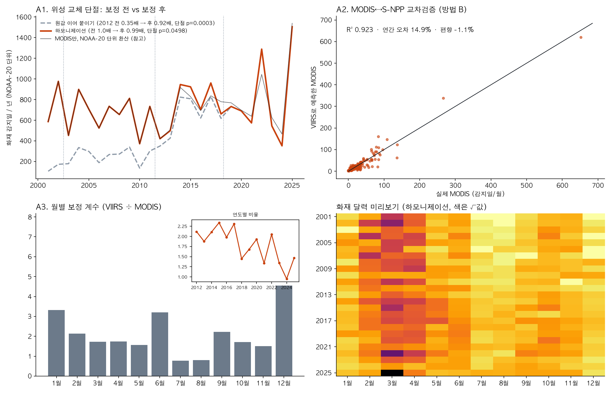

# Hwaruruk 🔥 — Data Pipeline

**Live web app:** [hwaruruk.unzipp.cloud](https://hwaruruk.unzipp.cloud/en)
**Backend API:** [NasaSpaceAppsSeoul_backend](https://github.com/NasaSpaceAppsSeoul/NasaSpaceAppsSeoul_backend)
**Raw data:** [hwaruruk_inputs.zip](https://github.com/NasaSpaceAppsSeoul/NasaSpaceAppsSeoul_data/releases/latest/download/hwaruruk_inputs.zip) (205 MB; NASA FIRMS through 2026-11-14 and official fire records)

NASA Space Apps Challenge 2026 · #9 Harmonization of MODIS and VIIRS Hot Spots · Team JJYa (Seoul)

## What it does

Satellite fire records break in 2012. MODIS (1 km) hands over to VIIRS (375 m), and joined as-is the same fires look 2–3× more frequent. This pipeline turns 25 years of NASA FIRMS hotspots into one continuous monthly record on the scale of NOAA-20, the satellite flying today, and computes everything the web app needs to say whether a month is **normal or unusual** for any area.

**Implemented**

- **Six regions on five continents:** South Korea (`KOR`), California (`CAL`), British Columbia (`BC`), Greece (`GRC`), Chile (`CHL`), New South Wales (`NSW`). 1,114 areas, monthly from 2001-01.
- **One unit, fire grid-days:** a 0.01° cell (about 1 km) with at least one detection on one local day, day and night together. Counting cells instead of points keeps a sharper sensor from looking like more fire.
- **Calibration chain to NOAA-20:** monthly ratios learned where satellites overlap, Terra → Terra+Aqua (2003–2011), MODIS → S-NPP (2012–2025, shrinkage 20; one fixed set or a ±2-year rolling set, whichever validates better per region) and S-NPP → NOAA-20 (2019–2025). NOAA-21 → NOAA-20 is learned too and kept on standby.
- **Validation:** leave-one-year-out prediction, a 2012 break test, independent checks against six agencies’ official fire records, and detection rate by fire size.
- **Per-area judgement:** “vs. normal” labels against 2001–2025, quality grades, typical fire season and peak month. Areas averaging under 11.1 grid-days a year borrow their parent region’s label instead of reporting noise.
- **Output for the backend:** JSON and CSV files per region (`output/<region>/`), loaded by the backend services.
- **Reproducible:** one command on Mac, Windows or Linux rebuilds every region and checks the result against stored baselines.

## Results

| Region | 2012 break, raw → harmonized (1.00 = none) | Leave-one-year-out monthly R² | Annual error | Official fires ≥ 100 ha seen within 2 days |
|---|---|---|---|---|
| South Korea | 2.61 → 0.99 | 0.92 | 15% | 91% |
| California | 2.06 → 1.02 | 0.98 | 7% | 86% |
| British Columbia | 2.38 → 1.00 | 0.96 | 9% | 93% |
| Greece | 2.80 → 1.01 | 0.97 | 6% | 80% |
| Chile | 2.73 → 1.02 | 0.88 | 11% | 94% |
| New South Wales | 3.00 → 1.03 | 0.84 | 10% | 95% |

Official records that never touch the satellites confirm the fix in South Korea (2.67 → 1.04), Chile (2.38 → 0.96) and NSW (2.92 → 1.05, by season). BC and Greece are inconclusive because their official records changed over time.

### What the notebook shows (South Korea)



Top left: annual fire grid-days, raw (dashed) versus harmonized (orange), with the 2012 step removed. Top right: leave-one-year-out check (R² 0.923). Bottom left: monthly MODIS → S-NPP ratios, from 0.78 in July to 4.54 in December. Bottom right: the 25-year calendar. Figure labels are in Korean; every number is also in `output/KOR/meta.json`.

The methodology page (`method_page.html`, English and Korean) explains each step with these numbers.

## Run it

**Requirements:** Python 3.12 (the baselines in `expected/` were made with it) and about 1 GB of disk for the raw data.

1. **Set up Python.**

```bash
python3 -m venv .venv && source .venv/bin/activate && pip install -r requirements.txt
```

On Windows (PowerShell): `py -3.12 -m venv .venv; .\.venv\Scripts\Activate.ps1; pip install -r requirements.txt`

2. **Get the raw data.** Download [hwaruruk_inputs.zip](https://github.com/NasaSpaceAppsSeoul/NasaSpaceAppsSeoul_data/releases/latest/download/hwaruruk_inputs.zip) and unzip it **in the repository root**, which creates `inputs/`. On Windows, keep the repository in a short path such as `C:\hwaruruk\`.

3. **Run all six regions and check the result.**

```bash
python tools/run_all.py --check
```

For each region it builds the notebook with `tools/make_notebook.py`, runs it, writes `output/<region>/`, then compares `output/<region>/meta.json` with `expected/<region>/meta.json`. Every region should report `같음` (identical). It takes 1–3 minutes per region; pick regions with `python tools/run_all.py GRC CHL`. The executed notebooks (`burnline_harmonization*.ipynb`) stay in the root with all figures and tables.

### Environment variables

| Variable | Default | Purpose |
|---|---|---|
| `BURNLINE_DATA` | `inputs` | Raw data folder, if not `inputs/` in the repository root. The layout inside must stay the same |
| `BURNLINE_COUNTRY` | `KOR` | Region of a notebook. `run_all.py` sets it for you |

No keys, passwords or accounts are needed: all inputs are public files.

### Raw data layout (`inputs/`)

```
inputs/
  firms/<region>/modis/    MODIS C6.1      fire_archive_*.csv, fire_nrt_*.csv
  firms/<region>/snpp/     VIIRS S-NPP
  firms/<region>/noaa20/   VIIRS NOAA-20
  firms/<region>/noaa21/   VIIRS NOAA-21
  official/<region>/       official fire records (validation only)
```

To refresh FIRMS data, download the same area from FIRMS Archive Download and unzip each file into `inputs/firms/<region>/<sensor>/`.

## Repository layout

| Path | Contents |
|---|---|
| `tools/make_notebook.py` | The whole calculation; it generates the notebook. Region settings live in `CONFIGS` |
| `tools/run_all.py` | Build, run and check every region |
| `tools/check_expected.py` | Compare `output/` with `expected/` |
| `tools/build_names.py`, `tools/transliterate.py` | Korean and English area names (`boundaries/<region>/names-<region>.csv`) |
| `tools/data_prep/` | Scripts that turned each agency’s download into `inputs/official/` (not needed to rerun) |
| `tools/site_extract.py`, `tools/mockup_extract.py` | Sample data for the design mockups in `mockup/` |
| `boundaries/<region>/` | Province and district boundaries (full and simplified) and display names |
| `expected/<region>/meta.json` | Baseline results for `--check` |
| `method_page.html` | Methodology page (English and Korean) |
| `문서/` | Planning documents and analysis reports (Korean) |

When a change alters results on purpose, update `expected/<region>/meta.json` with the new output in the same commit.

### Output (`output/<region>/`)

| File | Contents |
|---|---|
| `calendar.json` | Whole-region monthly record: harmonized value, raw value (`raw_before`), rank, ratio to normal, quality |
| `climatology.json` | Monthly normal and range |
| `calendar_by_province.json`, `calendar_by_region.json` | The same per province and per district |
| `regions.geojson` | District boundaries with data sufficiency, fire season, neighbors and names |
| `events.json`, `events_by_region.json` | Detection clusters (fires grouped across days and borders) |
| `meta.json` | Calibration ratios, validation, break tests, external validation |
| `hotspots_clean.csv` | Cleaned detections |

The backend reads these files from its data package, [hwaruruk_backend_data.zip](https://github.com/NasaSpaceAppsSeoul/NasaSpaceAppsSeoul_backend/releases/latest/download/hwaruruk_backend_data.zip).

## Limitations and unfinished work

- **Activity, not area:** fire grid-days measure fire activity as satellites see it, not burned area or fire counts. Prescribed and agricultural burns are included (autumn burning in northern Greece, hazard-reduction burns in NSW).
- **Before 2012:** values are estimates converted from MODIS, so districts are judged from 2012 onward.
- **Data snapshot:** FIRMS data through 2026-11-14, rerun by hand. Daily automatic NRT updates are not built yet.
- **NOAA-21:** learned from only two overlapping years, so it stays a standby link rather than a reference.
- **Fire radiative power (FRP):** computed from MODIS only and not harmonized; the web app does not use it.
- **Backend data package:** assembled from `output/`, `boundaries/` and the official records by hand; there is no packaging script in this repository yet.
- **Notebook figures:** labels are in Korean. They need a Korean font (AppleGothic, Malgun Gothic, NanumGothic or Noto Sans CJK KR); without one the labels show as boxes, and the numbers are unaffected.

## Data sources

| Source | Used for | Link |
|---|---|---|
| NASA FIRMS active fire: MODIS C6.1, VIIRS C2 (S-NPP, NOAA-20, NOAA-21) | All fire values | [FIRMS download](https://firms.modaps.eosdis.nasa.gov/download/) |
| Korea Forest Service: per-fire records and yearly counts by province (2001–2025) | Korea validation | [National Wildfire Information System](https://fd.forest.go.kr/ffas/pubConn/movePage/sub3.do) · [Forestry Statistics Platform](https://kfss.forest.go.kr/stat/ptl/newStat/newStatDtl.do?evntUpperSeq=8&evntSeq=46) |
| CAL FIRE FRAP California Fire Perimeters | California validation | [data.gov](https://catalog.data.gov/dataset/california-fire-perimeters-all) |
| BC Wildfire Service historical incidents | BC validation | [BC Data Catalogue](https://catalogue.data.gov.bc.ca/dataset/fire-incident-locations-historical) |
| Hellenic Fire Service forest fire records | Greece validation | [Internet Archive copy](https://web.archive.org/web/20260123051753/https://www.fireservice.gr/el/synola-dedomenon) · original xlsx in [this Release](https://github.com/NasaSpaceAppsSeoul/NasaSpaceAppsSeoul_data/releases/latest/download/greece_fire_service_2000-2024.zip) |
| CONAF statistics and per-fire records | Chile validation | [CONAF](https://www.conaf.cl/centro-documentals/estadisticas-historicas/) · [doi:10.71578/UXAUN5](https://doi.org/10.71578/UXAUN5) (CC BY 4.0) |
| NSW NPWS Fire History | NSW validation | [data.gov.au](https://www.data.gov.au/data/dataset/nsw-fire-history-wildfires-and-prescribed-burns-1e8b6) (CC BY) |
| geoBoundaries (CC BY 3.0/4.0), BC Data Catalogue (OGL–BC) | Area boundaries | [geoBoundaries](https://www.geoboundaries.org/) |

AI tools: Claude was used for writing and reviewing code and documentation.
